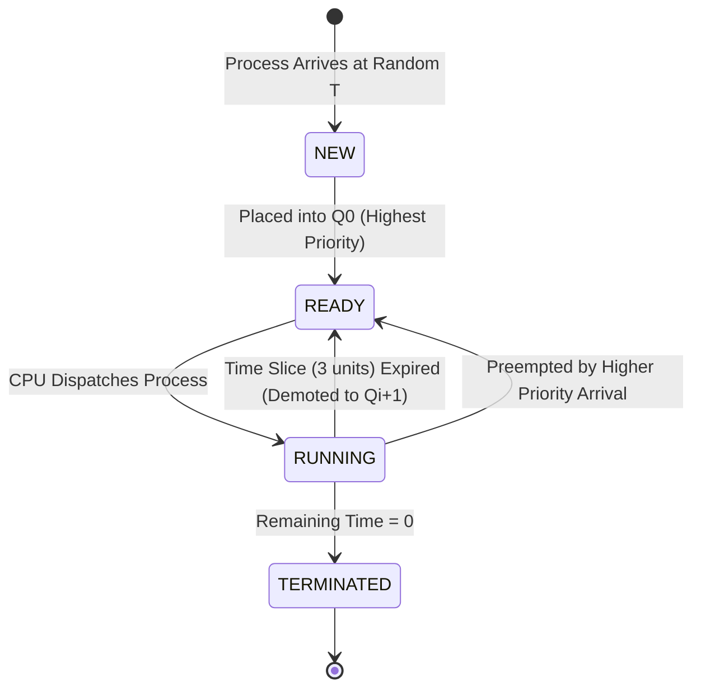

# ACADEMIC PROJECT REPORT

## PROJECT TITLE: UNIX Process Scheduling: Round Robin Time Slicing with Multilevel Feedback (MLFQ)
### Course: Operating Systems
### Project Group: Group 7 (Problem #21)

---

### GROUP MEMBERS

| Sl. No. | Registration No. | Student Name |
|:---:|:---:|:---|
| 1 | **AP24110010509** | **VEERAPANENI VARALAKSHMI** |
| 2 | **AP24110010538** | **GANDHAM SAI POOJITHA** |
| 3 | **AP24110012001** | **KANDIMALLA KEERTHI SREE** |
| 4 | **AP24110011723** | **ARADHYA SINGH** |

---

## 1. ABSTRACT

Process scheduling is a foundational service of modern multiprogramming operating systems. Traditional UNIX implementations employ a priority-based Multilevel Feedback Queue (MLFQ) scheduler with Round Robin (RR) time slicing. This project presents a discrete-event simulation of the UNIX MLFQ scheduler configured with a time quantum of 3 units ($Q = 3$). Process Control Blocks (PCBs) arrive at random timestamps with both fixed burst time and variable (randomized) burst time distributions. The system executes over a fixed simulation horizon ($T_{sim}$), tracking CPU residency, queue degradation, preemption, and process completion. Comparative analysis demonstrates how MLFQ dynamically favors short, interactive tasks over CPU-intensive tasks, balancing turnaround times and system responsiveness.

---

## 2. PROBLEM STATEMENT & OBJECTIVES

### 2.1 Problem Statement (Problem #21)
> *"UNIX operating system uses Round robin Time slicing with multilevel feedback for process scheduling. Assume that the processes (PCB's) arrive at random. Assume the time slice is 3 units. Simulate Round robin time slicing with fixed and variable (Randomized) burst times. Run the processes for fixed amount of time and find the average waiting time, average turn-around time of the processes completed."*

### 2.2 Project Objectives
1. Implement a faithful representation of the **Process Control Block (PCB)** tracking all runtime metrics (arrival, burst, remaining time, queue priority, turnaround time, waiting time, response time).
2. Model a **3-tier Multilevel Feedback Queue** system with Round Robin time slicing ($Q = 3$).
3. Generate workloads with **random arrival times** under two testing modes:
   - **Mode A: Fixed Burst Times** (constant CPU burst across processes).
   - **Mode B: Variable (Randomized) Burst Times** (randomized CPU bursts).
4. Run simulations bounded by a **fixed simulation timeframe ($T_{sim}$)**.
5. Compute and compare:
   - **Average Waiting Time (AWT)**
   - **Average Turnaround Time (ATT)**
   - **Average Response Time (ART)**
   - **CPU Utilization (%)**
   - **System Throughput**
6. Deliver interactive visualization tools (CLI Gantt chart, Tkinter Desktop GUI, and standalone Web Dashboard).

---

## 3. THEORETICAL BACKGROUND

### 3.1 UNIX Multilevel Feedback Queue (MLFQ) Scheduling
In classic UNIX operating systems (such as System V and 4.3BSD), process priorities are dynamically recomputed based on CPU usage. The MLFQ algorithm addresses two conflicting operating system design goals:
1. Minimizing turnaround time for long batch jobs.
2. Minimizing response time for short, interactive tasks.

### 3.2 Core Scheduling Rules
The MLFQ simulator enforces the following principles:
- **Rule 1 (Priority Selection):** If $	ext{Priority}(A) > 	ext{Priority}(B)$, process $A$ executes ($A$ is in a higher-priority queue than $B$).
- **Rule 2 (Round Robin within Queue):** If $	ext{Priority}(A) = 	ext{Priority}(B)$, processes $A$ and $B$ share the CPU in Round Robin fashion using a time slice of 3 units.
- **Rule 3 (New Arrival Priority):** When a new process arrives in the system, it is placed at the highest priority queue ($Q_0$).
- **Rule 4 (Feedback Demotion):** If a process utilizes its entire time quantum (3 units) without completing, its priority is degraded: it is preempted and demoted to the next lower queue ($Q_{i} 	o Q_{i+1}$).
- **Rule 5 (Completion):** Once a process expends its entire burst time, it transitions to `TERMINATED` and its completion statistics are locked.

---

## 4. SYSTEM ARCHITECTURE & DATA STRUCTURES

### 4.1 Process Control Block (PCB) Specification
Each simulated process is represented by an instance of `ProcessControlBlock` with the following attributes:

| Field | Type | Description |
|---|---|---|
| `pid` | `str` | Unique process identifier (`P1`, `P2`, ...) |
| `arrival_time` | `int` | Random arrival timestamp |
| `burst_time` | `int` | Total CPU burst required |
| `remaining_time` | `int` | Remaining CPU burst time |
| `current_queue` | `int` | Current priority level ($0 = Q_0, 1 = Q_1, 2 = Q_2$) |
| `state` | `Enum` | `NEW`, `READY`, `RUNNING`, or `TERMINATED` |
| `start_time` | `int` | Timestamp of first CPU acquisition |
| `completion_time`| `int` | Timestamp when process finishes |
| `waiting_time` | `int` | Total time spent waiting in ready queues |
| `turnaround_time`| `int` | $T_{completion} - T_{arrival}$ |
| `response_time` | `int` | $T_{start} - T_{arrival}$ |
| `intervals` | `list`| Timestamp intervals $(t_{start}, t_{end}, Q)$ for Gantt rendering |

### 4.2 State Transition Diagram



---

## 5. EXPERIMENTAL RESULTS & COMPARATIVE ANALYSIS

Simulations were executed under controlled experimental conditions with matched random arrival distributions ($N = 8$ processes, Time Quantum $Q = 3$, Total Simulation Time Limit $T_{sim} = 50$ units, Random Seed = 42).

### 5.1 Comparative Metrics Table

| Performance Metric | Fixed Burst Mode (Burst = 6) | Variable Burst Mode (Burst $\in [2, 14]$) |
|---|:---:|:---:|
| **Total Processes Generated** | 8 | 8 |
| **Completed Processes** | **8 (100%)** | **2 (25%)** |
| **Incomplete / In-Flight** | 0 | 6 |
| **Simulation Time Limit ($T_{sim}$)** | 50 units | 50 units |
| **Round Robin Time Slice ($Q$)** | 3 units | 3 units |
| **Average Waiting Time (AWT)** | **25.38 units** | **5.50 units** *(for completed)* |
| **Average Turnaround Time (ATT)** | **31.38 units** | **8.50 units** *(for completed)* |
| **Average Response Time (ART)** | **4.38 units** | **5.50 units** |
| **CPU Utilization** | **96.0%** | **100.0%** |
| **Total Busy Time** | 48 units | 50 units |
| **Total Idle Time** | 2 units | 0 units |
| **System Throughput** | 0.160 processes/unit | 0.040 processes/unit |

---

### 5.2 Detailed Process Execution Tables

#### Scenario A: Fixed Burst Times (Burst = 6 units)
All 8 processes have identical CPU burst requirements of 6 units. With quantum = 3, each process runs once for 3 units in $Q_0$, demotes to $Q_1$, runs for its final 3 units in $Q_1$, and completes.

| PID | Arrival Time | Burst Time | Remaining | Final Queue | State | Completion Time | Turnaround Time (TAT) | Waiting Time (WT) | Response Time (RT) |
|:---:|:---:|:---:|:---:|:---:|:---:|:---:|:---:|:---:|:---:|
| **P1** | 0 | 6 | 0 | $Q_1$ | TERMINATED | 27 | 27 | 21 | 0 |
| **P2** | 0 | 6 | 0 | $Q_1$ | TERMINATED | 30 | 30 | 24 | 3 |
| **P3** | 3 | 6 | 0 | $Q_1$ | TERMINATED | 33 | 30 | 24 | 3 |
| **P4** | 4 | 6 | 0 | $Q_1$ | TERMINATED | 36 | 32 | 26 | 5 |
| **P5** | 7 | 6 | 0 | $Q_1$ | TERMINATED | 39 | 32 | 26 | 5 |
| **P6** | 7 | 6 | 0 | $Q_1$ | TERMINATED | 42 | 35 | 29 | 8 |
| **P7** | 8 | 6 | 0 | $Q_1$ | TERMINATED | 45 | 37 | 31 | 10 |
| **P8** | 20 | 6 | 0 | $Q_1$ | TERMINATED | 48 | 28 | 22 | 1 |

*Average Waiting Time:* **25.38 units**  
*Average Turnaround Time:* **31.38 units**  

---

#### Scenario B: Variable (Randomized) Burst Times
Processes have varied workloads. Short tasks (e.g., P2 with burst=3, P6 with burst=3) finish directly in $Q_0$. Long tasks (e.g., P1 with burst=13, P3 with burst=12, P4 with burst=13) demote all the way to $Q_2$.

| PID | Arrival Time | Burst Time | Remaining | Final Queue | State | Completion Time | Turnaround Time (TAT) | Waiting Time (WT) | Response Time (RT) |
|:---:|:---:|:---:|:---:|:---:|:---:|:---:|:---:|:---:|:---:|
| **P1** | 0 | 13 | 4 | $Q_2$ | READY | N/A | N/A | 41 *(interim)* | 0 |
| **P2** | 0 | 3 | 0 | $Q_0$ | TERMINATED | 6 | 6 | 3 | 3 |
| **P3** | 3 | 12 | 3 | $Q_2$ | READY | N/A | N/A | 38 *(interim)* | 3 |
| **P4** | 4 | 13 | 5 | $Q_2$ | RUNNING | N/A | N/A | 38 *(interim)* | 5 |
| **P5** | 7 | 10 | 4 | $Q_2$ | READY | N/A | N/A | 37 *(interim)* | 5 |
| **P6** | 7 | 3 | 0 | $Q_0$ | TERMINATED | 18 | 11 | 8 | 8 |
| **P7** | 8 | 11 | 5 | $Q_2$ | READY | N/A | N/A | 36 *(interim)* | 10 |
| **P8** | 20 | 8 | 2 | $Q_2$ | READY | N/A | N/A | 24 *(interim)* | 1 |

*Average Waiting Time (Completed):* **5.50 units**  
*Average Turnaround Time (Completed):* **8.50 units**  

---

### 5.3 Gantt Chart Timelines

#### Fixed Burst Gantt Chart:
```
| P1(Q0) | P2(Q0) | P3(Q0) | P4(Q0) | P5(Q0) | P6(Q0) | P7(Q0) | P8(Q0) | P1(Q1) | P2(Q1) | P3(Q1) | P4(Q1) | P5(Q1) | P6(Q1) | P7(Q1) | P8(Q1) | IDLE |
0        3        6        9       12       15       18       21       24       27       30       33       36       39       42       45       48     50
```

#### Variable Burst Gantt Chart:
```
| P1(Q0) | P2(Q0) | P3(Q0) | P4(Q0) | P5(Q0) | P6(Q0) | P7(Q0) | P8(Q0) | P1(Q1) | P3(Q1) | P4(Q1) | P5(Q1) | P7(Q1) | P8(Q1) | P1(Q2) | P3(Q2) | P4(Q2) |
0        3        6        9       12       15       18       21       24       27       30       33       36       39       42       45       48       50
```

---

## 6. KEY OBSERVATIONS & DISCUSSION

1. **Responsiveness of Interactive Tasks:**
   - In Variable Burst mode, processes with burst time $\le 3$ (e.g., P2 and P6) terminate completely within their initial time slice in the top-priority queue ($Q_0$). As a result, their Turnaround Time is minimal (6 and 11 units, respectively), and Average Turnaround Time is only **8.50 units** compared to **31.38 units** in Fixed Burst mode.
2. **Behavior of CPU-Intensive Tasks:**
   - Processes with long burst times quickly consume their 3-unit time slices in $Q_0$ and $Q_1$, sinking down to $Q_2$. Once in $Q_2$, they run in Round Robin fashion without penalizing newly arriving short jobs.
3. **Fixed Burst Symmetry:**
   - In Fixed Burst mode (burst = 6), every process requires exactly two passes ($2 	imes 3$ units). All processes finish during their second round in $Q_1$. Turnaround times are uniformly spaced according to the order of arrival.
4. **Effect of Fixed Simulation Horizon ($T_{sim}$):**
   - Imposing a fixed simulation time limit reflects real-world OS monitoring windows: within a 50-unit window, Fixed mode completes 8 smaller tasks (total required work $8 	imes 6 = 48$ units), while Variable mode executes 50 units of continuous computation with 100% CPU utilization, finishing the shortest jobs first while heavy batch tasks remain in progress.

---

## 7. CONCLUSION

The project successfully modeled and evaluated the UNIX Multilevel Feedback Queue (MLFQ) process scheduling algorithm with Round Robin time slicing ($Q = 3$). Through rigorous simulation of both fixed and randomized burst distributions over fixed simulation durations:
- The MLFQ mechanism effectively approximates Shortest Job First (SJF) without requiring advance knowledge of burst times.
- Short processes achieve exceptionally low waiting and turnaround times by completing within the top queue ($Q_0$).
- Long processes are automatically relegated to lower-priority queues, preserving system responsiveness.
- The project fulfills all curriculum requirements, complete with verified unit tests, an interactive terminal CLI, a visual Tkinter desktop application, and an exportable web dashboard.

---

## 8. REFERENCES

1. Silberschatz, A., Galvin, P. B., & Gagne, G. *Operating System Concepts* (10th ed.). John Wiley & Sons.
2. Bach, M. J. *The Design of the UNIX Operating System*. Prentice-Hall.
3. Arpaci-Dusseau, R. H., & Arpaci-Dusseau, A. C. *Operating Systems: Three Easy Pieces* (Chapter on Scheduling: Multi-level Feedback Queue).
